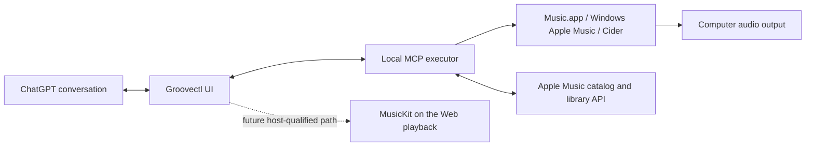

# ChatGPT Extensions: what Groovectl can use

Researched October 15, 2026. This separates the host's documented features, Groovectl's released behavior and proposed work. A feature in the protocol does not prove that every client implements it.

## The product promise

**Your Apple Music library, playlist studio and player controls inside ChatGPT.**

Today the extension is a control surface for a player on the executor's computer. Music.app, Windows Apple Music or Cider produces the audio. The Apple Music REST API supplies catalog, library and account operations; it is not a desktop transport API. A browser can stream through MusicKit on the Web, but that is a separate integration from the existing local-player adapters.

Do not advertise embedded full-track streaming, lossless playback, a universal cross-device remote or official Apple integration from the current receipts. The user chose polished Music.app/Cider control as the next milestone. A later MusicKit browser experiment remains worthwhile.

## Capability map

| Host feature | Useful Groovectl application | Current state and constraint |
| --- | --- | --- |
| Global/sidebar entrypoint | Open the full Library/Studio app without writing a prompt | Declared on `open_music`; global and current-chat entrypoints have distinct host navigation behavior. |
| Conversation panel | Browse a playlist while asking the agent to improve it | Declared. The user's screenshot establishes visible desktop rendering; it does not establish that the inspection controller can access the panel or that every action works. |
| Inline UI | A playlist preview, recording choice or compact player | Host supports it; the current app repeats the full workspace. Design a genuinely compact renderer before promoting inline use. |
| Fullscreen | Library, album/playlist details and the full studio | Declared. Account for the host composer and safe area; use the component's actual available size. |
| Picture-in-picture | A small now-playing surface while the chat continues | Documented host capability, not currently declared/qualified by Groovectl. Feature-detect and keep a compact inline fallback. Mobile may present it fullscreen. |
| Tool calls from UI | Direct play/pause, read a playlist, resolve a recording | Already uses the MCP Apps bridge. UI clicks can call existing tools without another model turn. Tool/host confirmation still applies where required. |
| Model context and user-triggered messages | “Use these three songs as anchors” or “Make Side B stranger” | Proposed. Send selected identities and relevant constraints, not the entire collection. An explicit user action triggers a conversational request. |
| Saved UI state | Restore route, filters, selected brief and scroll location | Host supports persisted widget state. Durable briefs/write receipts already live in private storage. Keep credentials and whole collections out of widget/model state. |
| Routing/deep links | Open a particular playlist, draft or activity receipt | Host-backed navigation and extension deep links are documented. Proposed typed routes must validate source namespaces and re-read private objects. |
| Structured plugin settings | View density, default route, follow-system theme | Proposed. MusicKit private keys, Apple passwords and Cider tokens remain in local CLI setup, never a ChatGPT form or model-visible setting. |
| Composer mentions | Select a specific playlist/draft as conversation context | Documented for desktop; proposed. Requires a bounded discovery/context interface, not a dump of the library. |
| Rich form elicitation | Optional interview, recipe or generated-cover selection | Documented. Keep the existing portable interview as fallback; forms augment natural language and never force a questionnaire. |
| File interfaces | Import/export a listening story or save a generated cover | Host file APIs are documented. Use advertised capabilities and explicit file selection. Do not register a catch-all JSON editor merely for playlist imports. |
| Server events | Refresh playback/artwork status without a model turn | Documented extension surface; Groovectl currently refreshes on connection/actions/manual request. A player-state resource/event adapter needs implementation and host qualification. |

Use standard MCP Apps APIs first. Add OpenAI-specific features only after checking the host capability. Ordinary MCP clients must retain the same useful tools without a dashboard.

## Playback has two different architectures

The chosen first path avoids making browser DRM a prerequisite for the product. Closing the extension should not stop music playing in the native player. A remote VPS in API-only mode cannot control a desktop player on another computer through the current adapters. A future device relay would be a separate authenticated feature, not an implication of having an MCP server.

For a later embedded-audio spike, prove script loading, authorization, a user-initiated full track, encrypted-media support, seeking, host lifecycle, tab visibility and sign-out in the actual desktop/web/mobile hosts. Document precisely where it works. Apple supports MusicKit browser playback; the OpenAI documentation reviewed does not establish Apple DRM support in its sandbox. Do not infer it from an ordinary audio player demo, embed the whole Apple Music website as a shortcut, scrape a third-party developer token or expose Cider's asset/DRM URLs.

## When the agent cannot see an open panel

Check the frontend computer before requesting another restart. In the October 15 desktop qualification, the user had Groovectl open in Windows ChatGPT while the current chat's computer-use controller was attached to the Mac. Its MCP Apps inventory was empty, although it could inspect the Mac's ordinary preview tabs. Windows had downloaded the same rc.2 runtime bytes. This was a cross-host inspection mismatch, not evidence that the plugin failed to render.

Keep three checks separate: which bundle the frontend has downloaded, where the selected MCP connection executes, and which frontend the UI controller can inspect. `get_capabilities` reports the tool connection's platform/player; it does not enumerate open frontend panels. A visible panel or a downloaded cache does not prove its current connection/version. Run the actual-panel test with the frontend and inspection controller on an accessible host; repeated plugin restarts do not change controller scope. The [qualification ledger](qualification.md) records sanitized findings, with detailed operator receipts stored outside the repository.

The local player runs on the MCP executor's computer. A Windows view of a chat whose tool connection reports `darwin` does not turn that connection into Windows player control. Use a Windows-local execution context for Windows playback, or the Mac frontend/controller for Mac qualification. [OpenAI's remote-connection guide](https://learn.chatgpt.com/docs/remote-connections) explains that MCP and Computer Use come from the connected host. Its Git-backed chat handoff transfers repository state and requires a matching saved project; do not move an unrelated repository merely to test a music panel.

## Network and artwork

The released app declares no external connect/resource domains. A library full of album artwork needs a deliberate change: allow only reviewed Apple artwork origins or fetch validated artwork through a bounded server resource. A catalog item's artwork template is data, not permission for arbitrary URLs. Keep scripts, fonts and icons bundled. Do not relax the CSP broadly to make a mockup render.

Direct local-player control remains behind MCP. Do not have an iframe contact Cider's loopback API with its token: that creates browser-local-network, authentication and deployment problems the existing adapter already avoids.

## UI libraries and Cider

OpenAI's optional Apps SDK UI kit is a useful host-style reference, and its documentation links a Figma component library. It is not a requirement to replace Groovectl's implementation. Proposed Groovectl components should use the host's theme/font variables, with original music-specific components and familiar music-player affordances.

Cider v1's repository is archived and identifies its source as AGPL-3.0. Cider-2's public README explicitly says its source is proprietary and unavailable. Study public behavior and integrate the documented authenticated RPC API; do not copy Cider components/assets into this MIT project as though they carried the existing upstream MIT notices. The Cider 4 binary tested on Windows is a live RPC target, not evidence that its frontend source is available.

## Source references

- [OpenAI Extensions](https://developers.openai.com/plugins/build/extensions): entrypoints, settings, forms, context, mentions, files and events.
- [OpenAI UI reference](https://developers.openai.com/plugins/reference): widget state, tool calls, display modes, navigation, file APIs and CSP.
- [OpenAI UI guidelines](https://developers.openai.com/plugins/concepts/ui-guidelines): inline/fullscreen/PiP roles, optional kit and Figma reference.
- [OpenAI plugin guidelines](https://developers.openai.com/plugins/plugin-guidelines): iframe and host testing requirements.
- [Apple MusicKit](https://developer.apple.com/musickit/): browser streaming and platform integration.
- [Cider v1](https://github.com/ciderapp/Cider) and [license](https://github.com/ciderapp/Cider/blob/master/LICENSE).
- [Cider-2 README](https://github.com/ciderapp/Cider-2): published source/license status; do not treat its older feature list as a current Cider 4 capability audit.
- [Cider RPC documentation](https://github.com/ciderapp/docs/blob/main/docs/1.client/rpc.md): integration boundary; verify exact endpoints against the installed version.

See [the dashboard brief](design/library-player-brief.md), [UI kit plan](ui-kit.md) and [qualification ledger](qualification.md).
